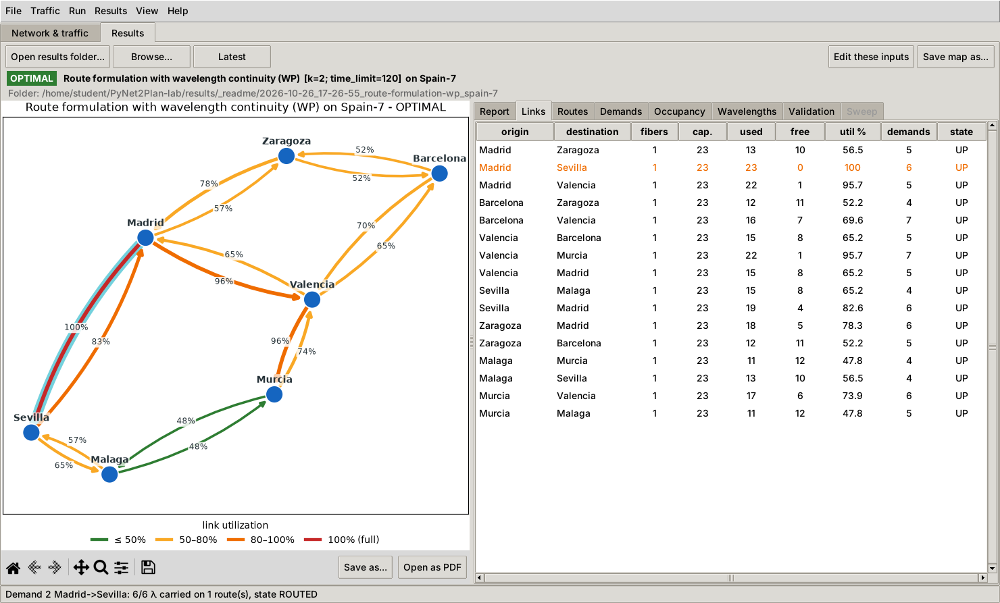

# PyNet2Plan

PyNet2Plan is a small network planning tool written in Python for the laboratory of the course
*Communication Network Design*. It is inspired by [Net2Plan](https://www.net2plan.com). A
network is a `networkx.DiGraph` whose nodes are named locations and whose edges are
unidirectional links; the traffic is a list of demands, read from a CSV file (demand list or
N × N matrix) or generated from a random seed; each algorithm is a Python file in
`formulations/`, with ILP models written in PuLP and heuristics written with NetworkX. The
result of every run is stored as a folder of CSV files that can be opened again in the
graphical interface.

Link capacities and demands are expressed in wavelengths. Each link (one direction between two
nodes) has a number of fibers, 1 by default, and a capacity of 40 wavelengths per fiber by
default; a link with f fibers of W wavelengths offers f × W wavelengths, and with wavelength
continuity each wavelength can be used once per fiber.



## Lab handouts

The handouts of the laboratory are in [`docs/lab/`](docs/lab/README.md):
[installation](docs/lab/00_installation.pdf) on macOS and Windows,
[tour of the tool](docs/lab/01_tool_overview.pdf),
[networks as NetworkX graphs](docs/lab/02_networkx_backend.pdf),
[the splittable flow formulation](docs/lab/03_first_ilp.pdf) (Lab 1). The
material of each lab is added to the repository before the lab: get it with `git pull` (see
below).

## 1. Installation

PyNet2Plan requires Python 3.10 to 3.14; version 3.14 is recommended. Python 3.15 cannot be used
yet, because some of the required packages are not available for it. The complete procedure for
macOS and Windows is described in [`docs/lab/00_installation.pdf`](docs/lab/00_installation.pdf).
In short:

```bash
git clone https://github.com/bonsai-lab-polimi/PyNet2Plan-lab.git
cd PyNet2Plan-lab
pip install -r requirements.txt   # preferably in a virtual environment, see handout 0
python -m pynet2plan doctor        # checks Python, NetworkX, PuLP and the ILP solvers
```

Before each lab, the material of that lab (handouts, exercises, scripts) is downloaded from the
project folder with

```bash
git pull
```

which adds the new files and keeps your work: the files of the exercises of a previous lab are
never changed. If git refuses because of local changes, save your work in a commit first
(`git add -A`, then `git commit -m "My work"`) and repeat `git pull`.

The requirements are NetworkX, Matplotlib and PuLP with the CBC and HiGHS solvers; the first
solver that works is used. Tkinter is part of the Python installers for Windows and macOS; on
Linux it is installed with `sudo apt install python3-tk`. The command `pip install -e .` also
installs a `pynet2plan` command that can be used from any folder.

## 2. Starting the program

```bash
python -m pynet2plan               # graphical interface (also: python main.py)
python -m pynet2plan --help        # command line
python -m pytest                  # tests
```

## 3. Working with the graphical interface

The menu *File > Open example* opens one of the reference networks together with its traffic
matrix. A typical session consists of the following steps.

1. Network. A topology is opened with *File > Open topology...* (`data/topologies/*.json`,
   GraphML or Net2Plan `.n2p` files), or built with the modes *Add node* and *Add link*, with
   *File > Add cities...* or with *File > Random topology...*. Failures are simulated by
   selecting a node or a link and pressing *Fail / repair selected*.
2. Traffic. A matrix is opened with *Traffic > Open traffic matrix...* (`data/traffic/*.csv`)
   or generated with *Traffic > Generate random traffic...*. The same seed on the same topology
   gives the same matrix on every computer, and the seed is stored in the saved file.
3. Run. An algorithm is selected at the bottom of the window, its parameters are set with
   *Parameters...*, and *Run* (F5) solves it in the background; *Cancel* stops the computation.
   The solution is checked independently of the algorithm (flow conservation, capacities,
   splitting, wavelengths) and saved as CSV files in a new folder of `results/`.
4. Results. The *Results* tab opens a saved run (*Open results folder...*, *Browse...*,
   *Latest*). The map is coloured by link utilization, and selecting links, routes or demands
   highlights the corresponding paths. The tabs *Report*, *Links*, *Routes*, *Demands*,
   *Occupancy*, *Wavelengths* (formulations with wavelength continuity) and *Validation*
   describe the run.
5. Comparison. *Compare (sweep)...* runs several algorithms for several link capacities and
   parameter values (for example `k=1,2,3`), saves all runs in one folder and plots the
   objective and the computation time as functions of the capacity. Each run is repeated
   (*Repetitions*, 5 by default) and the time is shown as the mean with error bars of one
   standard deviation.

The buttons *Open as PDF* below the map and the charts save them as vector PDF files (in the
folder of the run) and open them in the default PDF viewer, for use in reports; *Save as...*
saves them where you choose, as PDF, PNG or SVG files. *View > Text
size* enlarges all texts, which is useful on a projector. Further screenshots:
[network and traffic](docs/screenshot_network.png),
[wavelength assignment](docs/screenshot_wavelengths.png), [sweep charts](docs/screenshot_sweep.png).

## 4. Algorithms

| file | description | status |
|---|---|---|
| `splittable_flow.py` | link-flow ILP, demands may be split | complete |
| `_template.py` | starting point for new algorithms (not listed in the interface) | |

Each exercise contains numbered lines of the form `raise NotCompletedError("TODO n: ...")`,
which are replaced by the missing code. The file is read again at every run, so the interface
does not need to be restarted. The *Check* button runs the selected file on a small test
network designed to reveal common mistakes, such as a missing capacity constraint, a demand
split although splitting is not allowed, or two lightpaths on the same wavelength. Errors are
reported in a dialog with the corresponding status:

| status | meaning |
|---|---|
| `OPTIMAL`, `FEASIBLE` | valid solution, proved optimal or not (heuristic, time limit) |
| `BLOCKING` | valid solution in which part of the traffic is not routed (heuristics) |
| `NOT_COMPLETED` | a TODO is still present; the message gives file and line |
| `ERROR` | syntax error, exception or wrong return value; file, line and traceback are given |
| `INFEASIBLE`, `UNBOUNDED`, `TIME_LIMIT` | answer of the ILP solver (an unbounded model usually lacks a constraint) |
| `INVALID` | the model was solved but its solution violates a constraint, e.g. *Link Madrid->Zaragoza carries 46 wavelengths but its capacity is 40* |

The same checks are available without the interface:

```bash
python -m pynet2plan check formulations/splittable_flow.py     # small test network
python -m pytest tests/test_exercises.py -v                     # checks of the exercises
```

The tests of an exercise are skipped while it still contains TODOs. Once it is complete they
compare its results with known optimal values and with the complete formulations (for example,
the unsplittable optimum cannot be smaller than the splittable one). The interface that an
algorithm must implement is described in [`formulations/README.md`](formulations/README.md).


## 5. File formats

A topology file (`.json`) lists the nodes and the unidirectional links:

```json
{"name": "Spain-7",
 "nodes": [{"name": "Madrid", "lat": 40.4168, "lon": -3.7038}, ...],
 "links": [{"origin": "Madrid", "destination": "Zaragoza", "capacity": 40, "length": 274.1}, ...]}
```

The field `capacity` is the number of wavelengths of each fiber. The optional field `fibers`
(for example `"fibers": 2`) gives the number of fibers of the link and is 1 when omitted.
Parallel links found in GraphML, Net2Plan or older PyNet2Plan files become fibers of a single
link.

A traffic file (`.csv`) is either a list of demands or an N × N matrix; the format is detected
automatically. The separator may be a comma, a semicolon or a tab, and lines starting with `#`
are comments:

```
id,origin,destination,traffic          ,Madrid,Barcelona,Valencia
0,Madrid,Barcelona,3                   Madrid,0,3,1
1,Barcelona,Madrid,2                   Barcelona,2,0,4
                                       Valencia,1,1,0
```

Each run is saved in its own folder of `results/`:

| file | content |
|---|---|
| `summary.csv` | algorithm, parameters, status, objective, time, solver, carried and blocked traffic, utilization (one row) |
| `links.csv` | fibers, wavelengths per fiber, capacity (fibers × wavelengths per fiber), used and free wavelengths, utilization and number of demands of each link |
| `routes.csv` | demand, path and wavelengths of each route, with the wavelength indices when assigned |
| `demands.csv` | offered, carried and blocked wavelengths and state of each demand |
| `wavelengths.csv` | demand using each wavelength of each link (formulations with wavelength continuity) |
| `validation.csv`, `report.txt` | result of the independent check, text report |
| `topology.json`, `traffic.csv`, `formulation.py` | copies of the inputs and of the algorithm |

A folder is written whenever the algorithm returns a solution, including an invalid one, so
that the error can be examined. A sweep folder contains `sweep_summary.csv`, with one row per
run including the failed ones, and the run folders in `runs/`. The CSV files can be read with
Excel or pandas, e.g. `pd.read_csv("results/<run>/links.csv")`.

## 6. Data

The folder `data/topologies/` contains the reference networks `spain7` (7 nodes, 16 links),
`nsfnet14` (14 nodes, 42 links), `cost239` (11 nodes, 52 links), `italy10` (10 nodes, 30 links)
and `example_cities`, each with a traffic matrix in `data/traffic/`
(`italy10_traffic_matrix.csv` shows the N × N format). The matrix
`spain7_traffic_split_vs_unsplit.csv` is described in the example above and in
`data/README.md`. The folder `data/topologies/real/` contains 105 real topologies (GEANT,
ABILENE, CORONET, GERMANY50, ITALY and others, see `INDEX.md`), with synthetic traffic in
`data/traffic/real/`.

## 7. Command line and scripts

```bash
python -m pynet2plan run   -t data/topologies/spain7.json -d data/traffic/spain7_traffic.csv \
                          -a splittable_flow -p time_limit=30 --plot
python -m pynet2plan sweep -t data/topologies/spain7.json -d data/traffic/spain7_traffic.csv \
                          -a splittable_flow -c 20-40:5 -r 5
python -m pynet2plan traffic -t data/topologies/nsfnet14.json -n 30 --seed 7 -o my_traffic.csv
python -m pynet2plan report results/<folder>      # report of a run
python -m pynet2plan list                         # available algorithms and remaining TODOs
python labs/lab1_networkx_tour.py                # lab 1, NetworkX (handout 2)
python labs/lab1_exercises.py                    # lab 1, exercises on NetworkX (handout 2)
                                                 # (also as a notebook for Jupyter and Google Colab:
                                                 #  labs/lab1_exercises.ipynb)
python labs/lab1_first_ilp.py                    # lab 1, splittable flow formulation (handout 3)
```

The library can also be used from Python or Jupyter:

```python
from pynet2plan import network, traffic, runner, results

G = network.load_topology("data/topologies/spain7.json")        # a networkx.DiGraph
demands = traffic.load_traffic("data/traffic/spain7_traffic.csv", G)
res = runner.run_algorithm(G, demands, "splittable_flow", {"time_limit": 60})
print(res.status, res.summary["objective"], res.folder)
run = results.load_run(res.folder)                                # the saved CSV files
```

## 8. Project layout

```
pynet2plan/        the library (network, traffic, solution, validation, runner, results, gui, ...)
formulations/     the algorithms: complete formulations and exercises
data/             topologies and traffic matrices
labs/             scripts used in the lab sessions
results/          output of the runs (not under version control)
tests/            tests, run with python -m pytest
tools/            maintenance scripts (reference data, handouts)
docs/             lab handouts (docs/lab), screenshots, example charts, Net2Plan user's guide
```
