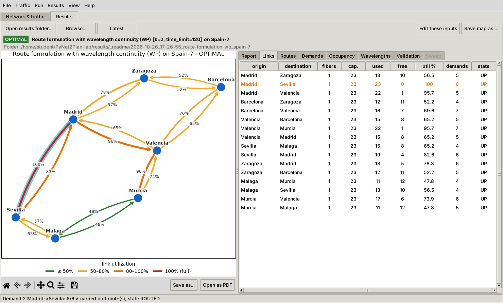
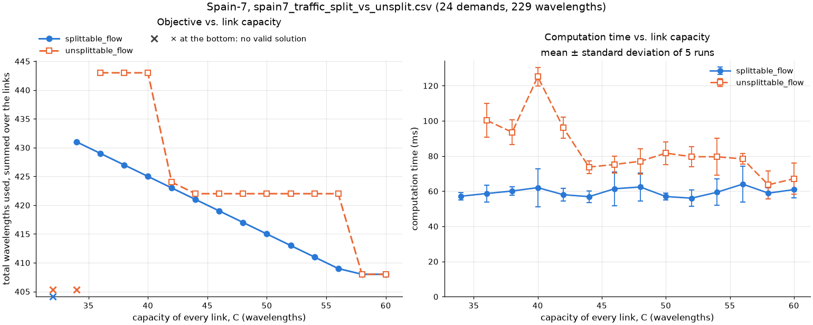

# PyNet2Plan

PyNet2Plan is a small network planning tool written in Python for the laboratory of the course
*Communication Network Design*. It is inspired by [Net2Plan](https://www.net2plan.com). A
network is a `networkx.DiGraph` whose nodes are named locations and whose edges are
unidirectional links; the traffic is a list of demands, read from a CSV file (demand list or
N × N matrix) or generated from a random seed; each algorithm is a Python file in
`formulations/`, with ILP models written in PuLP and heuristics written with NetworkX. The
result of every run is stored as a folder of CSV files that can be opened again in the
graphical interface.

Link capacities and demands are expressed in wavelengths. Each link (one direction between two
nodes) has a number of fibers, 1 by default, and a capacity of 40 wavelengths per fiber by
default; a link with f fibers of W wavelengths offers f × W wavelengths, and with wavelength
continuity each wavelength can be used once per fiber.



## Lab handouts

The handouts of the laboratory are in [`docs/lab/`](docs/lab/README.md):
[installation](docs/lab/00_installation.pdf) on macOS and Windows,
[tour of the tool](docs/lab/01_tool_overview.pdf),
[networks as NetworkX graphs](docs/lab/02_networkx_backend.pdf),
[the splittable flow formulation](docs/lab/03_first_ilp.pdf) (Lab 1),
[the unsplittable flow formulation](docs/lab/04_unsplittable_flow.pdf) and
[the route formulation](docs/lab/05_route_formulation.pdf) (Lab 2),
[the route formulation with 1+1 protection](docs/lab/06_protection_route_formulation.pdf) (Lab 3).
Lab 4 (elastic optical networks) uses the EON window, `python -m pynet2plan eon` (section 4b). The
material of each lab is added to the repository before the lab: get it with `git pull` (see
below).

## 1. Installation

PyNet2Plan requires Python 3.10 to 3.14; version 3.14 is recommended. Python 3.15 cannot be used
yet, because some of the required packages are not available for it. The complete procedure for
macOS and Windows is described in [`docs/lab/00_installation.pdf`](docs/lab/00_installation.pdf).
In short:

```bash
git clone https://github.com/bonsai-lab-polimi/PyNet2Plan-lab.git
cd PyNet2Plan-lab
pip install -r requirements.txt   # preferably in a virtual environment, see handout 0
python -m pynet2plan doctor        # checks Python, NetworkX, PuLP and the ILP solvers
```

Before each lab, the material of that lab (handouts, exercises, scripts) is downloaded from the
project folder with

```bash
git pull
```

which adds the new files and keeps your work: the files of the exercises of a previous lab are
never changed. If git refuses because of local changes, save your work in a commit first
(`git add -A`, then `git commit -m "My work"`) and type `git pull --no-rebase --no-edit`. Once
you have commits of your own, always use this form: a plain `git pull` stops with *Need to
specify how to reconcile divergent branches*.

The requirements are NetworkX, Matplotlib and PuLP with the CBC and HiGHS solvers; the first
solver that works is used. Tkinter is part of the Python installers for Windows and macOS; on
Linux it is installed with `sudo apt install python3-tk`. The command `pip install -e .` also
installs a `pynet2plan` command that can be used from any folder.

## 2. Starting the program

```bash
python -m pynet2plan               # graphical interface (also: python main.py)
python -m pynet2plan --help        # command line
python -m pytest                  # tests
```

## 3. Working with the graphical interface

The menu *File > Open example* opens one of the reference networks together with its traffic
matrix. A typical session consists of the following steps.

1. Network. A topology is opened with *File > Open topology...* (`data/topologies/*.json`,
   GraphML or Net2Plan `.n2p` files), or built with the modes *Add node* and *Add link*, with
   *File > Add cities...* or with *File > Random topology...*. Failures are simulated by
   selecting a node or a link and pressing *Fail / repair selected*.
2. Traffic. A matrix is opened with *Traffic > Open traffic matrix...* (`data/traffic/*.csv`)
   or generated with *Traffic > Generate random traffic...*. The same seed on the same topology
   gives the same matrix on every computer, and the seed is stored in the saved file.
3. Run. An algorithm is selected at the bottom of the window, its parameters are set with
   *Parameters...*, and *Run* (F5) solves it in the background; *Cancel* stops the computation.
   The solution is checked independently of the algorithm (flow conservation, capacities,
   splitting, wavelengths) and saved as CSV files in a new folder of `results/`.
4. Results. The *Results* tab opens a saved run (*Open results folder...*, *Browse...*,
   *Latest*). The map is coloured by link utilization, and selecting links, routes or demands
   highlights the corresponding paths. The tabs *Report*, *Links*, *Routes*, *Demands*,
   *Occupancy*, *Wavelengths* (formulations with wavelength continuity) and *Validation*
   describe the run.
5. Comparison. *Compare (sweep)...* runs several algorithms for several link capacities and
   parameter values (for example `k=1,2,3`), saves all runs in one folder and plots the
   objective and the computation time as functions of the capacity. Each run is repeated
   (*Repetitions*, 5 by default) and the time is shown as the mean with error bars of one
   standard deviation.

The buttons *Open as PDF* below the map and the charts save them as vector PDF files (in the
folder of the run) and open them in the default PDF viewer, for use in reports; *Save as...*
saves them where you choose, as PDF, PNG or SVG files. *View > Text
size* enlarges all texts, which is useful on a projector. Further screenshots:
[network and traffic](docs/screenshot_network.png),
[wavelength assignment](docs/screenshot_wavelengths.png), [sweep charts](docs/screenshot_sweep.png).

## 4. Algorithms

| file | description | status |
|---|---|---|
| `splittable_flow.py` | link-flow ILP, demands may be split | complete |
| `unsplittable_flow.py` | link-flow ILP, one path per demand | exercise (solution in `solutions/`) |
| `route_formulation_vwp.py` | route (path) ILP without wavelength continuity | exercise |
| `_template.py` | starting point for new algorithms (not listed in the interface) | |

Each exercise contains numbered lines of the form `raise NotCompletedError("TODO n: ...")`,
which are replaced by the missing code. The file is read again at every run, so the interface
does not need to be restarted. The *Check* button runs the selected file on a small test
network designed to reveal common mistakes, such as a missing capacity constraint, a demand
split although splitting is not allowed, or two lightpaths on the same wavelength. Errors are
reported in a dialog with the corresponding status:

| status | meaning |
|---|---|
| `OPTIMAL`, `FEASIBLE` | valid solution, proved optimal or not (heuristic, time limit) |
| `BLOCKING` | valid solution in which part of the traffic is not routed (heuristics) |
| `NOT_COMPLETED` | a TODO is still present; the message gives file and line |
| `ERROR` | syntax error, exception or wrong return value; file, line and traceback are given |
| `INFEASIBLE`, `UNBOUNDED`, `TIME_LIMIT` | answer of the ILP solver (an unbounded model usually lacks a constraint) |
| `INVALID` | the model was solved but its solution violates a constraint, e.g. *Link Madrid->Zaragoza carries 46 wavelengths but its capacity is 40* |

The same checks are available without the interface:

```bash
python -m pynet2plan check formulations/splittable_flow.py     # small test network
python -m pytest tests/test_exercises.py -v                     # checks of the exercises
```

The tests of an exercise are skipped while it still contains TODOs. Once it is complete they
compare its results with known optimal values and with the complete formulations (for example,
the unsplittable optimum cannot be smaller than the splittable one). The interface that an
algorithm must implement is described in [`formulations/README.md`](formulations/README.md).

### Example: splittable and unsplittable flow

With the original traffic of Spain-7 the splittable and unsplittable formulations often reach
the same optimum. The matrix `data/traffic/spain7_traffic_split_vs_unsplit.csv` (24 demands of
4 to 16 wavelengths, 229 in total) was chosen so that the two differ: the unsplittable model
cannot fill the scarce links exactly, so it needs more wavelengths, or has no solution, for
most capacities between 34 and 56.



| uniform capacity C | splittable | unsplittable |
|---|---:|---:|
| up to 33 | infeasible | infeasible |
| 34 | 431 | infeasible |
| 35 | 430 | 460 |
| 36 to 40 | 429 to 425 | 443 |
| 42, 44 to 56 | 423, 421 to 409 | 424, 422 |
| 57 and above | 408 | 408 |

The objective is the total number of wavelengths used on all links; for C = 41 and C = 43 the
two formulations give the same value. The comparison can be repeated in the interface (*File >
Open example > Spain-7: splittable vs unsplittable*, then *Compare (sweep)...* with
`splittable_flow` and `unsplittable_flow` and capacities `32-60:2`) or from the command line:

```bash
python labs/lab1_comparison.py
python -m pynet2plan sweep -t data/topologies/spain7.json \
       -d data/traffic/spain7_traffic_split_vs_unsplit.csv \
       -a splittable_flow -a unsplittable_flow -c 32-60:2
```

The unsplittable series appears once `formulations/unsplittable_flow.py` has been completed;
before that its runs have status `NOT_COMPLETED`.

## 4b. Elastic optical networks (EON): RSA, 1+1 protection, 3R

A separate window for **elastic optical networks**, built from the same
pieces (map, tables, background runs, CSV results) but independent of the
wavelength algorithms above:

```bash
python -m pynet2plan eon
```

Every link has **4000 GHz** of spectrum (Lab 4, part 1), cut on the flexible grid into **slots of
12.5 GHz** (320 slots, Lab 4), and a demand asks for a **data rate in Gb/s**. It is carried by one or more
**lightpaths**, each with a **transponder type** of the table
`data/eon/transponders.csv` (the lecture slide *"Amplification and 3R
regeneration"*: rate, modulation, channel spacing → slots, **reach**, cost).
RSA (Routing and Spectrum Assignment) must respect the **reach** (of the
path, or of every segment with 3R), **contiguity** (adjacent slots),
**continuity** (the same slots on every link) and **non-overlap**. Every
unidirectional link has its own spectrum; a **fibre** is a pair of opposite
links (what a cut takes down, what 1+1 must avoid).

| lab | file (`formulations/eon/`) | what | status |
|---|---|---|---|
| 3 | `rsa_greedy.py` | no protection, no 3R: the greedy plan (Lab 4: greedy RSA, k shortest paths, fewest slots, first-fit) | **given** |
| 3 | `rsa_1plus1_two_step.py` | 1+1 protection, two-step (shortest path, then backup) | **given** |
| 3 | `rsa_1plus1_ilp.py` | 1+1 protection: route formulation (ILP), the pairs of all the demands together | **given** |
| 4 | `rsa_3r.py` | 3R regeneration (reach per segment, spectrum per segment) | **exercise** |

The solutions are checked independently (reach, contiguity, continuity,
non-overlap, 1+1 disjointness, 3R only at intermediate nodes) and saved in
`results/eon/`. The window shows the spectrum of every link, what each
**fibre cut** takes down (or switches to the backup path), the **cost**
(hardware + `C_SLOT` × slots, with the break-even price of a slot between two
runs) and the comparisons of several runs. *Run → Fair comparison* compares no protection and
1+1 on the same demands. *Cut / repair fibre* (Network tab) cuts a fibre
**after planning** (several fibres can be cut; the button cuts or repairs the selected one; without
*cut both directions* only the selected direction is cut, `D>E` in the results):
the algorithms still plan on the whole network, and every result opens showing what the cuts do
to the plan (demands DOWN in red, demands switched to their 1+1 backup in purple). To plan
*without* a fibre, delete it. A traffic file can ask for cuts with a line `# cut fibre: D-E` or
`# cut fibres: D-E, B-C` (`D>E`: only that direction; teaching example 3 of Lab 4 cuts Murcia-Valencia). The network and the demands can be edited on the
map, as in the main window: modes *Add node*, *Add link* (two clicks, then the
length in km — it decides which transponders reach), *Add demand* (two clicks,
then the Gb/s), *Delete selected*, *Edit km…* in the Links tab. Any topology can be used (*File → Open topology…*,
also the real ones of `data/topologies/real/`): its EON traffic is loaded with
it. EON traffic (Gb/s, 100–800 per demand) has its own folder,
**`data/traffic_eon/`**, with a file for every network (real ones in
`data/traffic_eon/real/`); `data/traffic/` is in wavelengths, for the main
window — loaded in the EON window it would make every demand a single 100G
QPSK, so the window asks first. How to write an EON algorithm:
[`formulations/eon/README.md`](formulations/eon/README.md).

**Teaching examples** on Spain-7, the network of the wavelength labs (*File → Teaching
examples*, files `data/traffic_eon/spain7_lab4_*.csv`, `spain7_first_plan.csv` and `spain7_lab4_3r.csv`), each
built so that one comparison shows clearly (4000 GHz = 320 slots per link). Those of Lab 4, part 1 show the
spectrum in GHz, those of Lab 4 in slots. The exercises and the lecture's examples use EON-6:

| example | demands | no protection, no 3R (`rsa_greedy`) | 1+1 | 3R | what it shows |
|---|---:|---|---|---|---|
| Lab 4, 1: no protection vs 1+1 (fibre Murcia-Valencia cut after planning) | 40 | 40 served, 100 transp., 9700 GHz; cut: 17 DOWN | 40 served, 218 transp., 26750 GHz; cut: 0 down, 17 switched | | the price (2.2× transponders, 2.8× spectrum) and the gain of protection |
| Lab 4, 2: no protection vs 1+1 heuristic vs 1+1 ILP (1200 GHz per link, Murcia-Valencia cut) | 40 | 40 planned, 22 after the cut | two-step 25, ILP (`rsa_1plus1_ilp`) 29, all still served after the cut | | the ILP chooses the pairs of all the demands together |
| Lab 4, 3: one demand with 1+1 | 1 | 1 lightpath (700G), 2 transponders | 1 + 2 backup lightpaths (400G), 6 transponders | | Madrid → Valencia, 700 Gb/s: the backup detour (832 km) is too long for 700G |
| Lab 4, 4: RSA on the grid of slots | 30 | 30 served, 512 slots | | | contiguity and continuity on the grid of slots; first-fit |
| Lab 4, 5: no 3R vs 3R | 100 long, 500–800 Gb/s | 93 served, 3388 slots | | 100 served, 2696 slots, 63 × 3R | 3R lets the fast types go far: more demands in fewer slots, more hardware |

A demand is carried by **n lightpaths of one transponder type** (e.g. 600 Gb/s
over 1200 km = 2 × 300G PCS 16QAM), never by a mix such as 500G PCS 16QAM +
100G QPSK; a 3R keeps the type (rate, modulation, slots) of its lightpath.
`best_combination` chooses this way and the checker rejects a mix. In the
Lightpaths table a 3R is written on the path and every segment shows its own
spectrum, e.g. on EON-6 `A > D > E [3R] > F`, `A-D-E: 200-250 GHz | E-F: 200-250 GHz`.
The window shows the spectrum in **GHz** by default (Lab 4, part 1: protection and 3R, before the slots);
*View → Spectrum in slots* shows every spectrum quantity in slots of 12.5 GHz (Lab 4). The teaching
examples switch to their unit by themselves (a traffic file can ask for one with
`# spectrum unit: GHz` or `# spectrum unit: slots`).

Reference values, EON-6 (*File → Open example*, the 6-node network of the
lecture) with its 120 demands and 320 slots per link:

| | RSA | RSA + 1+1 | RSA + 3R |
|---|---:|---:|---:|
| demands served | 120 | 78 (42 blocked: spectrum) | 120 |
| lightpaths | 155 | 101 + 113 backup | 152 |
| transponders / 3R | 310 / 0 | 428 / 0 | 304 / 11 |
| total slots used (slots × links) | 1768 | 3564 | 1636 |
| demands down, worst single fibre cut | 45 | 0 | 45 |

On the 78 demands both serve, 1+1 needs 2.1× the transponders and 3.3× the
spectrum of RSA, and no demand goes down whatever fibre is cut. RSA + 3R is
the cheaper network once a slot costs more than 0.12 (hardware: a
transponder = 1, a 3R = 2). The slide's example is reproduced exactly (A→C at
200 Gb/s: 300G PCS 16QAM on 8 slots without 3R; 200G 16QAM with a 3R at B on
slots 4–7 of A–B and 12–15 of B–C). These numbers differ from the EON
notebook's, whose links share one spectrum for both directions.

```bash
python -m pynet2plan eon-run -t data/topologies/eon6.json -d data/traffic_eon/eon6_traffic.csv -a rsa_greedy --plot
python -m pynet2plan eon-sweep -t data/topologies/eon6.json -d data/traffic_eon/eon6_traffic.csv \
       -a rsa_greedy -a rsa_3r --axis num_demands --values 20-120:20
python -m pynet2plan eon-protection -t data/topologies/eon6.json -d data/traffic_eon/eon6_traffic.csv
python -m pynet2plan eon-traffic -t data/topologies/eon6.json -n 120 --seed 42 -o my_eon_traffic.csv
python -m pynet2plan eon-cost --rate 1200 --span 200      # long reach or 3R? break-even price of a slot
python -m pytest tests/test_eon_exercises.py -v           # tests of the EON algorithms
```

## 5. File formats

A topology file (`.json`) lists the nodes and the unidirectional links:

```json
{"name": "Spain-7",
 "nodes": [{"name": "Madrid", "lat": 40.4168, "lon": -3.7038}, ...],
 "links": [{"origin": "Madrid", "destination": "Zaragoza", "capacity": 40, "length": 274.1}, ...]}
```

The field `capacity` is the number of wavelengths of each fiber. The optional field `fibers`
(for example `"fibers": 2`) gives the number of fibers of the link and is 1 when omitted.
Parallel links found in GraphML, Net2Plan or older PyNet2Plan files become fibers of a single
link.

A traffic file (`.csv`) is either a list of demands or an N × N matrix; the format is detected
automatically. The separator may be a comma, a semicolon or a tab, and lines starting with `#`
are comments:

```
id,origin,destination,traffic          ,Madrid,Barcelona,Valencia
0,Madrid,Barcelona,3                   Madrid,0,3,1
1,Barcelona,Madrid,2                   Barcelona,2,0,4
                                       Valencia,1,1,0
```

Each run is saved in its own folder of `results/`:

| file | content |
|---|---|
| `summary.csv` | algorithm, parameters, status, objective, time, solver, carried and blocked traffic, utilization (one row) |
| `links.csv` | fibers, wavelengths per fiber, capacity (fibers × wavelengths per fiber), used and free wavelengths, utilization and number of demands of each link |
| `routes.csv` | demand, path and wavelengths of each route, with the wavelength indices when assigned |
| `demands.csv` | offered, carried and blocked wavelengths and state of each demand |
| `wavelengths.csv` | demand using each wavelength of each link (formulations with wavelength continuity) |
| `validation.csv`, `report.txt` | result of the independent check, text report |
| `topology.json`, `traffic.csv`, `formulation.py` | copies of the inputs and of the algorithm |

A folder is written whenever the algorithm returns a solution, including an invalid one, so
that the error can be examined. A sweep folder contains `sweep_summary.csv`, with one row per
run including the failed ones, and the run folders in `runs/`. The CSV files can be read with
Excel or pandas, e.g. `pd.read_csv("results/<run>/links.csv")`.

## 6. Data

The folder `data/topologies/` contains the reference networks `spain7` (7 nodes, 16 links),
`nsfnet14` (14 nodes, 42 links), `cost239` (11 nodes, 52 links), `italy10` (10 nodes, 30 links)
and `example_cities`, each with a traffic matrix in `data/traffic/`
(`italy10_traffic_matrix.csv` shows the N × N format). The matrix
`spain7_traffic_split_vs_unsplit.csv` is described in the example above and in
`data/README.md`. The folder `data/topologies/real/` contains 105 real topologies (GEANT,
ABILENE, CORONET, GERMANY50, ITALY and others, see `INDEX.md`), with synthetic traffic in
`data/traffic/real/`. They come from the Topology Bench dataset (R. Matzner et al., *Journal of
Optical Communications and Networking*, vol. 17, no. 1, pp. 7-27, 2024,
[doi:10.1364/JOCN.534477](https://doi.org/10.1364/JOCN.534477)), distributed under the
CC BY 4.0 license; `data/README.md` gives the full reference and the changes made.
The traffic of the EON window, in Gb/s, is in `data/traffic_eon/`, with one file for every
network (section 4b).

## 7. Command line and scripts

```bash
python -m pynet2plan run   -t data/topologies/spain7.json -d data/traffic/spain7_traffic.csv \
                          -a splittable_flow -p time_limit=30 --plot
python -m pynet2plan sweep -t data/topologies/spain7.json -d data/traffic/spain7_traffic.csv \
                          -a splittable_flow -c 20-40:5 -r 5
python -m pynet2plan traffic -t data/topologies/nsfnet14.json -n 30 --seed 7 -o my_traffic.csv
python -m pynet2plan report results/<folder>      # report of a run
python -m pynet2plan list                         # available algorithms and remaining TODOs
python labs/lab1_networkx_tour.py                # lab 1, NetworkX (handout 2)
python labs/lab1_exercises.py                    # lab 1, exercises on NetworkX (handout 2)
                                                 # (also as a notebook for Jupyter and Google Colab:
                                                 #  labs/lab1_exercises.ipynb)
python labs/lab1_first_ilp.py                    # lab 1, splittable flow formulation (handout 3)
```

Lab 2:

```bash
python labs/lab2_unsplittable.py                 # unsplittable vs splittable (handout 4)
python labs/lab2_route_formulation.py            # route vs flow formulation (handout 5)
python labs/lab1_comparison.py                   # splittable/unsplittable and route/flow comparisons
python -m pynet2plan sweep -t data/topologies/spain7.json -d data/traffic/spain7_traffic.csv \
                          -a splittable_flow -a "route_formulation_vwp:k=1,2,3" -c 20-40:5 -r 5
```

The library can also be used from Python or Jupyter:

```python
from pynet2plan import network, traffic, runner, results

G = network.load_topology("data/topologies/spain7.json")        # a networkx.DiGraph
demands = traffic.load_traffic("data/traffic/spain7_traffic.csv", G)
res = runner.run_algorithm(G, demands, "splittable_flow", {"time_limit": 60})
print(res.status, res.summary["objective"], res.folder)
run = results.load_run(res.folder)                                # the saved CSV files
```

## 8. Project layout

```
pynet2plan/        the library (network, traffic, solution, validation, runner, results, gui, ...)
pynet2plan/eon/    elastic optical networks: transponders, spectrum, checker, runner, results, plotting
formulations/     the algorithms: complete formulations and exercises
data/             topologies and traffic matrices
labs/             scripts used in the lab sessions
results/          output of the runs (not under version control); EON runs in results/eon/
tests/            tests, run with python -m pytest
tools/            maintenance scripts (reference data, handouts)
docs/             lab handouts (docs/lab), screenshots, example charts, Net2Plan user's guide
```
